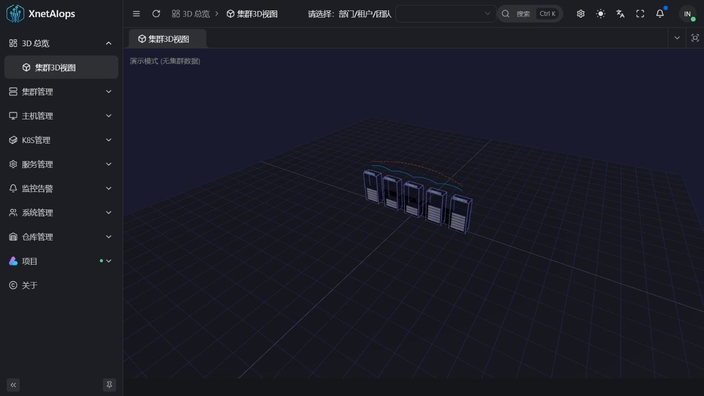
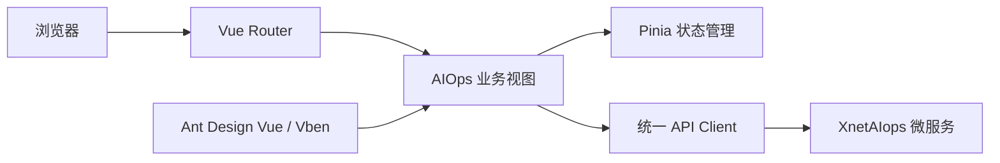

<div align="center">

# XnetAIops Web

**XnetAIops 智能运维平台的 Web 控制台**

[](https://github.com/synapxnet/XnetAIops-web/releases/tag/v1.3.0) [](https://vuejs.org/) [](https://www.typescriptlang.org/) [](./LICENSE)

[后端仓库 XnetAIops](https://github.com/synapxnet/XnetAIops/tree/v1.3.0) · [OpenXnet 开源社区](https://openxnet.synapxnet.com) · [查看许可](./LICENSE)

</div>

## 主线开发

基于 v1.3.0 的平台功能继续演进，保留驻场 Agent、知识与 Skill 工作台、跨域取证、受控执行、独立验证、审计与恢复。主线默认不加载比赛账号、组织、固定场景或竞赛服务地址。

[主线迁移范围](./docs/MAINLINE-TRANSITION.md) · [历史发布](https://github.com/synapxnet/XnetAIops-web/releases)



## 页面预览

| 账号登录 | 关于项目 |
| --- | --- |
|  |  |

## 项目简介

XnetAIops Web 是由 **SynapXnet 团队**开源的智能运维控制台，也是 XnetAIops 微服务体系的统一交互入口。控制台将主机、集群、服务、监控、Kubernetes 与镜像仓库集中到同一套界面中，便于运维人员在一个工作区完成日常巡检与变更操作。

本仓库是平台前端，与 [XnetAIops](https://github.com/synapxnet/XnetAIops/tree/v1.3.0) 后端仓库共同组成企业级、多租户、前后端分离系统。项目基于 Vue 3、TypeScript、Vite、Ant Design Vue，并采用 [Vue Vben Admin 框架](https://github.com/vbenjs/vue-vben-admin) 构建，适合继续扩展企业级运维场景。

## 项目优势

- **企业多租户**：面向不同组织和团队提供清晰的角色、权限与资源视图。
- **前后端分离**：独立发布 Web 控制台，便于对接不同网关、服务和部署环境。
- **统一工作台**：在同一界面管理主机、集群、服务、监控、Kubernetes 与镜像仓库。
- **持续更新**：SynapXnet 团队会持续完善体验、自动化能力、安全性与项目文档。

## 功能模块

| 模块         | 主要功能                                                |
| ------------ | ------------------------------------------------------- |
| 3D 总览      | 以三维场景展示集群与节点拓扑，提供运维态势入口          |
| CLM 集群管理 | 集群纳管、基础组件部署、部署任务与生命周期操作          |
| HOM 主机管理 | 主机、机架、SSH 连接与资源信息维护                      |
| SVM 服务管理 | 服务概览、命令执行、框架配置及服务生命周期管理          |
| MON 监控告警 | 监控指标、告警历史、告警规则与异常追踪                  |
| K8S 管理     | 集群资源、工作负载、网络、存储、RBAC、Helm 与交付流水线 |
| REG 仓库管理 | 镜像仓库、项目、标签、同步和部署日志                    |
| USR 系统管理 | 用户、角色、权限码与平台访问控制                        |

## 前端架构



## 技术栈

- Vue 3 + TypeScript
- Vite + Turbo
- Ant Design Vue + Vben Admin
- Pinia + Vue Router
- pnpm 9.15.7

## 主线构建

使用 **Node.js 20.10.0 或更高版本**、固定的 **pnpm 9.15.7**。前端基于 Vue 3、TypeScript 5、Vite、Ant Design Vue 与 Vben 工作区：

```bash
cd XnetAIops-web
corepack enable
corepack prepare pnpm@9.15.7 --activate
pnpm install --frozen-lockfile
pnpm exec turbo build --filter=@vben/web-antd --env-mode=loose
```

产物为 `apps/web-antd/dist`；通过配套 Nginx 或自己的 HTTPS 网关发布。仅启动静态前端不能启动业务后端或驻场 Agent。

### 本地开发与接口

开发命令为 `pnpm dev:antd`，默认端口 `5777`。代理默认使用本机后端，可通过 AIOPS_USR_DEV_URL、AIOPS_CLM_DEV_URL、AIOPS_HOM_DEV_URL、AIOPS_SVM_DEV_URL、AIOPS_MON_DEV_URL、AIOPS_K8S_DEV_URL、AIOPS_REG_DEV_URL 配置各服务目标。开发代理不会自动发现服务器，也没有完整的驻场代理配置。

生产 `.env.production` 使用同源 `/api/usr`、`/api/clm`、`/api/hom`、`/api/svm`、`/api/mon`、`/api/k8s`、`/api/reg`。驻场 `/api/resident/v1/` 要由网关另行接到独立 Node 服务。后端、驻场、模型凭据和登录授权须分别配置；浏览器中不存放模型 API Key。

主线验证记录见 docs/MAINLINE-TRANSITION.md；历史交付说明保留历史基线。

## 部署与登录

使用当前部署环境提供的访问地址，网页 API 默认同源。登录调用 POST /api/usr/sms-code 发送一次性验证码，再使用 POST /api/usr/login 登录；身份、驻场状态接口分别为 /api/usr/user/info、/api/resident/v1/status。

管理员需创建真实账号与组织成员关系，并配置 Redis、JWT_SECRET、XNET_SMS_GATEWAY_URL 和 XNET_SMS_GATEWAY_TOKEN。主线不预置任何通用验证码或公共登录账号。验证码 5 分钟有效、60 秒发送间隔、最多 5 次错误、成功后立即销毁。短信网关接收 POST JSON {phone, code, purpose: "login", expiresInSeconds: 300}，通过 Bearer token 鉴权，必须返回 HTTP 2xx 与 {"accepted": true}。未配置或发送失败时明确报错。

驻场 Agent、审批、模型服务沿用各自配置与权限边界。前端跨平台导航使用 VITE_XNET_AIOPS_URL、VITE_XNET_DATAOPS_URL、VITE_XNET_MLOPS_URL；未配置则不显示对应外链。


## SynapXnet 开源生态

本项目属于 SynapXnet 开源项目矩阵。访问 [OpenXnet](https://openxnet.synapxnet.com) 获取更多团队项目与社区信息。

## 参与贡献

欢迎提交 Issue 与 Pull Request。新增页面时请复用现有布局、权限、路由与请求层约定，并确保桌面端常见分辨率下的交互完整性。

## 开源许可

本项目基于 [MIT License](./LICENSE) 开源。前端采用 [Vue Vben Admin 框架](https://github.com/vbenjs/vue-vben-admin)，并依法保留上游项目的 MIT 版权与许可声明。
